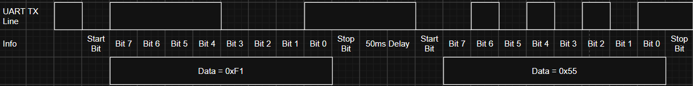
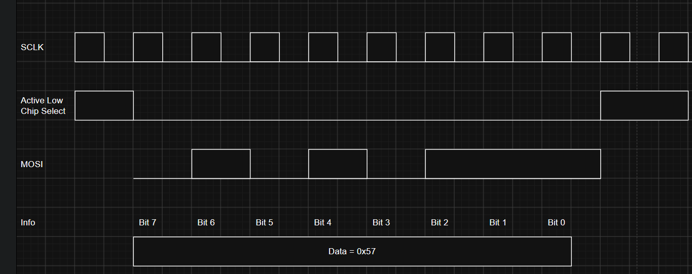

# ECE-528 HW 3

1. Overview

Author: Dominic Sanqui

Date: 11/15/26

Class: ECE-528

Assignment: Homework 3

Description: The purpose of this assignment is to review the eUSCI_A modules and develop functions to configure them.

2. Components Used
N/A

3. Analysis and Results 
N/A

4. References

[1] "MSP432P4xx SimpleLink Microcontrollers Technical Reference Manual", Texas Instruments.

[2] https://www.totalphase.com/blog/2021/12/i2c-vs-spi-vs-uart-introduction-and-comparison-similarities-differences/ 

[3] https://www.seeedstudio.com/blog/2019/09/25/uart-vs-i2c-vs-spi-communication-protocols-and-uses/

[4] https://www.seeedstudio.com/blog/2019/11/22/spi-introduction-to-serial-peripheral-interface/

## Section I: Review Questions

1. The MSP432 uses the eUSCI_A modules for UART communication. Describe the function of the following registers:
- UCAxBRW (Baud Rate Control Word)

This register is used to set the baud rate of the eUSCI_A module will generate with respect to the clock source. For example, we have a 12 MHz clock source and want to set the module to a baud rate of 9600. To do this, the UCAxBRW register is set to the result of 12 MHz divided by 9600 to configure the module to generate a baud rate of 9600 [1].

- UCAxMCTLW (Modulation Control Word)

This register is used to enable or disable oversampling mode. This mode is used to configure the module to use either a low frequency or high frequency clock input. Additionally, this register is used to set the modulation pattern based on the frequency setting selected. In low frequency mode, one modulator is used to generate clock signals. In high frequency mode, two modulators are used to generated clock signals [1].

- UCAxCTLW0 (Control Word 0)

This register is used to configure several different settings of the module. The module can be configured to have even parity, odd parity, or no parity. It can transmit either most significant bit (MSB) or least significant bit (LSB) first. The bit length of data to transmit can be set to be either 7 or 8 bits. It can use one or two stop bits. It can set the mode of the module to be UART, idle multiprocessor, address bit multiprocessor, or UART with automatic baud rate detection mode. The module can be set to operate in either asynchronous or synchronous enable mode. It can choose which clock source to use. It can be enabled to have receive error character or break character interrupts. It can be placed into sleep mode. It can identify the next frame transmitted to be either data or an address. Additionally it can identify the next frame to be transmited is a break or not. Lastly, this register can set the module into a reset or operational state which should be done first before updating any other setting of the module [1].

- UCAxRXBUF (Receive Buffer)

The receive shift register stores the last received character into this register. When this register is read, the receive error bits, the read interrupt flag bit, and the address or idle bit is reset. This register can have a different endian mode based on whether or not the module has been configured to read and write data in 7 or 8 bits [1].

- UCAxTXBUF (Transmit Buffer)

This register stores the data that will be transferred to the transmit shift register. When this register is written to, the transmit interrupt flag bit is reset. The MSB is reset and unused when the module is configured to read or write with a bit length of 7 [1]. 


2. What is the purpose of the UCAxSTATW status register in the UART module? Which bits indicate the following?

First, this register can be used to tell the module to send and receive data only to itself in a loop. Second, this register can be used to indicate if there is an error with the data based on framing, overruns, parity, or receiving. Third, this register can be used to indicate if there is a break in data transmission. Fourth, this register can be used to confirm if the address or idle line has been received in address bit or idle line multiprocessor mode respectively. Lastly, this register indicates if the module is busy or not [1].

- Whether the UART module is currently transmitting?

UCBUSY - bit 0

- Whether a framing, parity, or overrun error has occurred

UCFE - bit 6 - framing error

UCPE - bit 4 - parity error

UCOE - bit 5 - overrun error

- Whether the RX buffer contains unread data

UCADDR/UCIDLE - bit 1

3. Assume that the eUSCI_A3 module is using SMCLK as its clock source, which has a frequency of 12 MHz. Calculate the value that is needed to be written to the UCAxBRW register to configure the eUSCI_A3 module for 115200 baud.

N = 12 MHz / 115200 = 12,000,000 / 115200 = 104
[1]

4. a. Write a function named UART2_Init that configures the eUSCI_A2 module for the following settings:
- Baud Rate: 115200
- Data Length: 8 bits
- Parity: None
- Stop Bits: 1
- Bit Order: MSB First
- Clock Source: SMCLK (12 MHz)
- Pins: P3.2 (UCA2TXD) and P3.3 (UCA2RXD)

```
void UART2_INIT(void)
{
    //Hold eUSCI_A2 module in reset mode
    EUSCI_A2->CTLW0 |= 1;

    //Clear modulation register
    EUSCI_A2->MCTLW = 0;

    //Set module to UART mode, 8 bit length, no parity, 1 stop bit
    //MSB first, SMCLK clock source, and hold module in reset mode
    EUSCI_A2->CTLW0 |= 0x20C1;

    //Set module to 115200 baud rate
    EUSCI_A2->BRW = 104;

    //Configure P3.2,3.3 as primary UART function
    P3->SEL0 |= 0x0C;
    P3->SEL1 &= ~0x0C;

    //Disable interrupts
    EUSCI_A2->IE &= ~0xF;

    //Start eUSCI_A2 module
    EUSCI_A2->CTLW0 &= ~0x0001;

}

```

b. Suppose that you have a program that is transmitting data using the eUSCI_A2 module given the configuration in part a. Draw the waveform for the UART TX data line if the main program is transmitting two btyes: 0xF1 followed by 0x55. Clearly label the start bits, data bits, and stop bits. Assume that there is a 50 ms delay between the two bytes.

Figure 1: UART TX Waveform for Question 4b [1]


5. What is the function of the eUSCI_B module? How does SPI communication differ from the UART communication in terms of:

The function of the eUSCI_B module is to support either inter-integrated circuit (I2C) or serial peripheral interface (SPI) serial communication modes [2].

- Synchronization

In SPI, a master device transmits a clock signal to all of the slave devices to ensure all devices in the system are able to synchronize correctly to send and receive data. In contrast, UART uses baud rate rather than a clock to synchronize the transfer of data. This technique requires that both the transmitter and receiver devices must have a baud rate that is at most 10% apart from each other to avoid the loss of data [2]. 

- Clocking 

In SPI, a clock is generated from the master device and provided to the slave devices. In UART, there is no clock [2].

- Signaling

In SPI, there is one master device and multiple slave devices. The master device will select a slave device to communicate with by setting that slave device's chip select (SS) line to 0. In UART, the device that will transmit data will set the transmit channel which is 1 when not in use to 0 as a start bit to indicate to the receiver device that data will be sent [2, 3]. 

- Data Framing

In SPI, a data frame is generally eight bits and is transmitted in order from MSB to LSB. For the eUSCI_B module, it can have a data frame with 7 or 8 bits and transmitted in order from LSB to MSB or vice versa. In UART, a data frame can include data bits, an address bit, a parity bit, and stop bits. There can be 7 or 8 data bits. These data bits can be transmitted in order from LSB to MSB and vice versa. Additionally, there can be 2 stop bits [1, 3]. 


6. a. Explain the role of the following SPI signals:
- SCLK

This is the clock signal that is generated from the master device and sent to all of the slave devices. This clock signal ensures that each device knows when to sample a bit [3].

- CS

This is the chip select signal. These signals are fed to each slave device and are set to 1 by default. When the master device is ready to begin communication, it will set the chip select signal to 0 for the slave device it desires to speak to, so the slave device is aware that data should be tranmsitted or received [2, 3]. 

- MISO

This is the master data input and slave data output signal. This signal is the channel where the slave device sends data to the master device [2, 3, 4].

- MOSI

This is the master data output and slave data input signal. This signal is the channel where the master device sends data to a slave device [2, 3, 4]. 

b. What happens if multiple SPI peripheral devices have their CS line asserted simultaneously on the MSP432?

When this occurs, communication between the master and multiple slave devices will happen simultaneously. For the MOSI, this is may be acceptable because the master is sending the same data to multiple devices. The acceptability of this situation is dependent on the function of the slave devices. For the MISO, this is unacceptable because multiple slaves send their data on the same channel to the master device. This can cause the data that the master receives to be scrambled, because the master does not know how to parse the data of multiple devices at the same time [4].

7. a. Briefly describe the function of the UCBxCTLW0 (Control Word 0) register from the eUSCI_B module.

This register can be used to configure the module to be in either I2C or SPI mode, reset the module, set the clock source to use, or set the module to be in master or slave mode. It can also be used to set the length of the address frames as well as indicate that specific control bits like acknowledge, start, or stop [1].

b. Which bits need to be cleared or set in the UCBxCTLW0 register to configure the SPI mode used by the eUSCI_B module? Provide a description of each bit.

- UCMODEx - needs to be set to 0, 1, or 2 to use SPI mode instead of SPI mode. 
- UCSWRST - needs to be cleared to allow the module to operate instead of reset.
[1]

c. Which field in the UCBxCTLW0 register selects the clock source used by the eUSCI_B module? Provide the values used and the corresponding clock sources.

UCSELx - Register that is used to select the clock source
- 00b = Reserved
- 01b = ACLK
- 10b = SMCLK
- 11b = SMCLK
[1]

8. a. Write a function named EUSCI_BO_SPI_Init that configures the eUSCI_BO module for SPI communication with the following settings:
- SPI Mode: 0
- Data Length: 8 bits
- Bit Order: MSB First
- Clock Source: SMCLK (12 MHz)
- SPI Clock Frequency: 1 MHz
- SPI Format: 3-wire SPI
- SPI pins:
    - P1.5: SCLK (UCB0CLK)
    - P1.6: MOSI (UCB0SIMO)
    - P1.7: MISO (UCB0SOMI)
    - P9.0 Active Low Chip Select (GPIO)

b. If a main program transmits one byte with a value of 0x57, draw the waveforms for:
- Chip Select (Active Low)
- SCLK
- MOSI

Figure 2: SPI MOSI Waveform for Question 8b [1]
